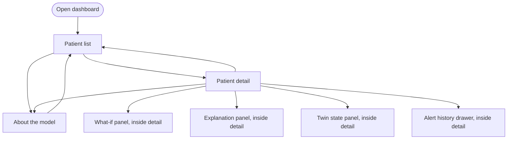
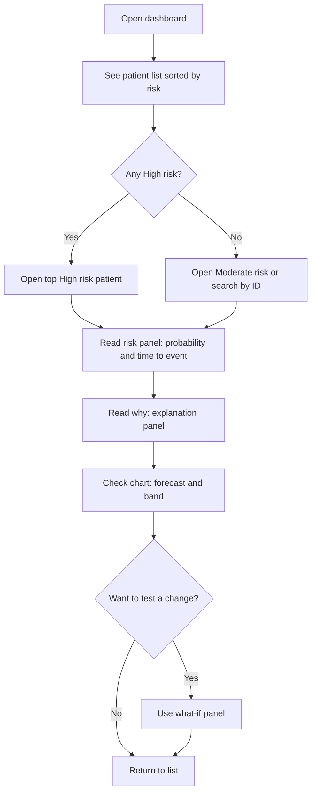
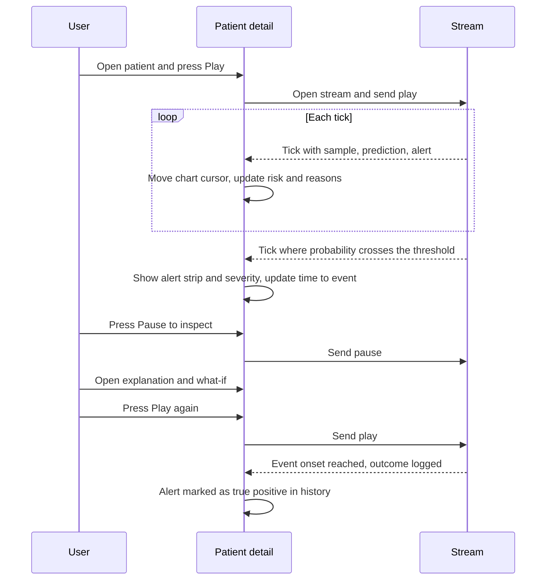
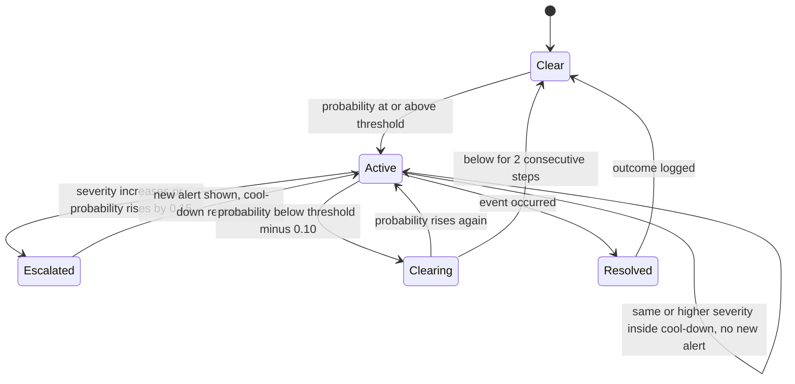
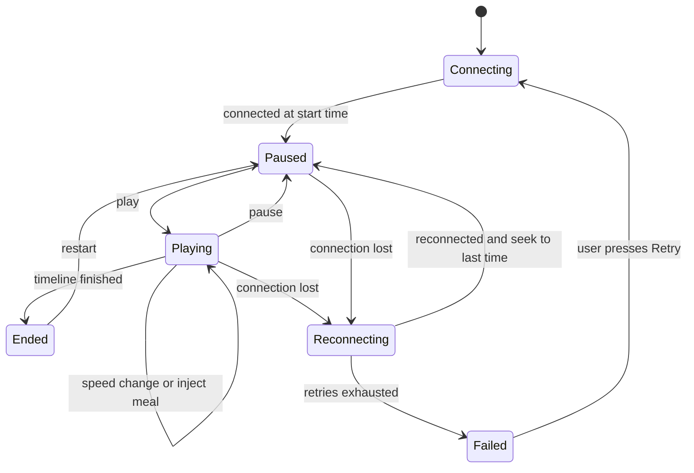
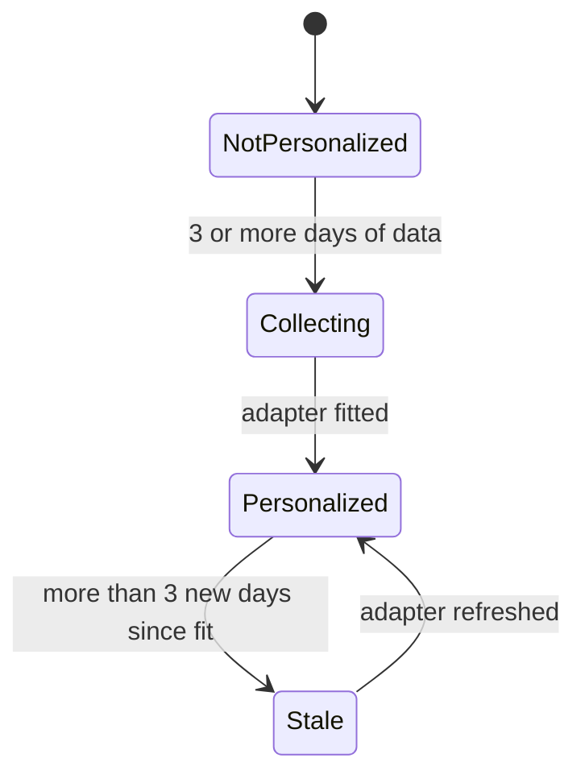

# App Flow

**Project:** GlucoTwin (working title)
**Related documents:** `PRD.md`, `TRD.md`, `ARCHITECTURE.md`, `BACKEND-SCHEMA.md`
**Version:** 1.0
**Date:** 2026-10-02

This document describes what a user sees and does: the screens, the paths between them, what each screen shows in every state, and the rules that drive alerts, replay, and the twin status.

---

## 1. Purpose

The dashboard has one job: let a doctor understand a virtual patient in about 30 seconds, then test a change. Every screen and flow below serves that job. Anything that does not help is left out.

## 2. Users and entry points

| User | How they arrive | What they want first |
|---|---|---|
| Doctor (primary persona) | Opens the dashboard URL | Who needs attention now |
| Jury member | Opens the dashboard during or after the video | A working demo, metrics, honesty about data |
| Team member presenting | Runs the scripted demo flow (section 6.5) | A flawless 5 to 8 minute live segment |

There is no login in the prototype. The first screen is the patient list.

## 3. Screen map



| Route | Screen | Purpose |
|---|---|---|
| `/` | Patient list | Triage by current risk |
| `/patients/:id` | Patient detail | Inspect one virtual patient, run replay, test what-if |
| `/about` | About the model | Metrics, data provenance, limitations |
| `*` | Not found | Link back to the patient list |

Every screen shows the **prototype banner** at the top: "Research prototype. Synthetic data only. Not for clinical use."

## 4. Screen specifications

### 4.1 Patient list (`/`)

**Purpose:** show every virtual patient sorted by current risk so the doctor knows where to look first.

**Layout:**

```
+--------------------------------------------------------------------------+
| BANNER: Research prototype. Synthetic data only. Not for clinical use.   |
+--------------------------------------------------------------------------+
| GlucoTwin                                     [About the model]          |
+--------------------------------------------------------------------------+
| Search: [__________]   Filter: [All risk levels v]   Sort: [Risk v]      |
+--------------------------------------------------------------------------+
| Patient   Age/Sex  Glucose   Trend   Risk      Time to event  Twin status|
| P-0042    54 F     156 mg/dL  up     HIGH      ~75 min        Personal.  |
| P-0017    61 M     142 mg/dL  flat   MODERATE  ~110 min       Personal.  |
| P-0008    47 F     118 mg/dL  down   LOW       none           Learning   |
+--------------------------------------------------------------------------+
```

**Data:** `GET /patients` (name or ID, age, sex, current glucose, trend, risk level, time to event, twin status, last update).

**Behavior:**

| Action | Result |
|---|---|
| Click a row | Navigate to `/patients/:id` |
| Type in search | Filter by ID or fictional name |
| Change filter or sort | Re-order locally, no extra request |
| List data older than 60 seconds while replay is running elsewhere | Auto-refresh every 15 seconds |

**States:**

| State | What the user sees |
|---|---|
| Loading | Skeleton rows |
| Empty | "No patients found. Run `make demo-data` to create the demo cohort." |
| Error | Message with a Retry button, and the API health status |
| Low confidence patient | Risk shown as "Low confidence" with a gray badge and a tooltip explaining why |

### 4.2 Patient detail (`/patients/:id`)

**Purpose:** the main working screen. Everything for one patient is on one page.

**Layout (desktop):**

```
+--------------------------------------------------------------------------+
| BANNER                                                                   |
+--------------------------------------------------------------------------+
| < Back to list      P-0042                              [About the model]|
+----------------------------+---------------------------------------------+
| PATIENT CARD               | RISK PANEL                                  |
| 54 y, F, BMI 29.4          |  HIGH   probability 78%                     |
| HbA1c 8.1%  eGFR 78        |  Expected above 180 mg/dL in about 75 min   |
| Metformin, Glimepiride     |  Predicted peak about 238 mg/dL             |
| Hypertension               |  [View alert history]                       |
| TWIN STATE                 +---------------------------------------------+
| Personalized, 6 days data  | WHY (explanation panel)                     |
| Data quality: 99% / 94%    |  Last meal 42%  Sleep 23%                   |
|                            |  Glucose trend 18%  Background risk 17%     |
+----------------------------+---------------------------------------------+
| GLUCOSE CHART                                                            |
| history line, forecast line, P10 to P90 band, 70 and 180 reference lines |
| [Play] [Pause] Speed [900x v]  Time 19:45  [Add meal now]                |
| Text summary: Glucose is 156 and rising, predicted above 180 in ~75 min  |
+--------------------------------------------------------------------------+
| WHAT-IF PANEL                                                            |
| Add meal [ 0 ] g at +[ 0 ] min   Walk [ 20 ] min at +[ 15 ] min  [Run]   |
| Peak 238 -> 201 mg/dL   Event probability 78% -> 41%                     |
| Model estimate for exploration, not medical advice.                      |
+--------------------------------------------------------------------------+
```

On narrower screens the panels stack in this order: risk, explanation, chart, patient card, what-if, twin state.

**Panels:**

| Panel | Shows | Data source |
|---|---|---|
| Patient card | Demographics, key labs, medicines, comorbidities | `GET /patients/:id` |
| Twin state | Personalization status, days of data, last RMSE before and after adapter, data completeness | `GET /patients/:id` |
| Risk panel | Severity, probability, time to event, predicted peak | Prediction (REST or stream tick) |
| Explanation panel | Factor shares with direction and a one-sentence summary | `GET /patients/:id/explain` |
| Glucose chart | History, forecast, band, reference lines, replay cursor | Stream ticks and `GET /patients/:id/timeseries` |
| Replay controls | Play, pause, speed, seek, add meal | WebSocket control messages |
| What-if panel | Edit form, before and after comparison | `POST /patients/:id/whatif` |
| Alert history drawer | Past alerts with outcome (event occurred or not) | `GET /patients/:id/alerts` |
| Data quality bar | Completeness per channel and age of last update | Prediction response |

**States:**

| State | Behavior |
|---|---|
| Loading | Skeleton card and chart |
| Paused at start | Chart shows the last 24 hours up to the start time, controls show Play |
| Playing | Chart advances one grid step per tick, risk and explanation update on every tick |
| Alert active | Risk panel shows the severity color, icon, and text, and a slim alert strip appears above the chart |
| Low confidence | Alert suppressed, gray banner "Low confidence: not enough recent sensor data" |
| Stream disconnected | Yellow bar "Connection lost, reconnecting" with automatic retry, resumes from the last time received |
| Timeline ended | Controls show Replay from start |
| API error | Inline error with Retry for the failing panel only, the rest of the page keeps working |

### 4.3 What-if panel (inside patient detail)

**Controls:**

| Control | Range | Notes |
|---|---|---|
| Add meal | 0 to 200 g carbohydrates, start offset 0 to 120 minutes ahead in 15 minute steps | Preset buttons: Light snack 25 g, Normal meal 70 g, Heavy meal 110 g |
| Walk | Duration 10 to 60 minutes, start offset 0 to 120 minutes | Presets: 10, 20, 30 minutes |
| Skip next meal | Toggle | Only appears if a meal is expected in the next 2 hours |
| Reset | Clears all edits | |

**Flow:** the doctor edits controls, presses Run, the panel shows a loading state for under a second, then shows baseline and scenario side by side and overlays the scenario forecast on the chart as a dashed line. A summary sentence is generated, for example: "With a 20 minute walk at +15 minutes, the predicted peak drops from 238 to 201 mg/dL and event probability from 78% to 41%."

**Rules:**

- The what-if never changes stored patient data and never changes the live replay.
- Values outside the allowed range are blocked in the form, with an inline message.
- The disclaimer is always visible next to the result.

### 4.4 Explanation panel (inside patient detail)

- Shows up to five factors as horizontal bars with percentage, a text label, and an arrow for raises or lowers risk.
- Colors are never the only signal. Each bar has a text label and a numeric share.
- A one-sentence summary appears above the bars.
- A small "How is this calculated?" link opens a short popover: "Attributions show how much each group of inputs moved the predicted risk compared with a typical reference. They explain the model, they do not prove a cause."

### 4.5 Twin state panel

| Status | Meaning | What the doctor sees |
|---|---|---|
| Not personalized | Fewer than 3 days of data | "Using the general model. Learning this patient." |
| Collecting | Between 3 and 6 days, adapter not yet fitted | "Enough data to personalize soon." with a Personalize button |
| Personalized | Adapter fitted | "Personalized on 6 days of data." plus before and after error numbers |
| Stale | New data of more than 3 days since the last fit | "Adapter is out of date." with a Refresh button |

The Personalize or Refresh button calls `POST /patients/:id/personalize`, shows progress for a few seconds, then updates the status.

### 4.6 About the model (`/about`)

| Section | Content |
|---|---|
| What this is | Two sentences on the purpose and the condition chosen |
| Data | Table of datasets, type (real open or synthetic), license, and role. Statement that all data is synthetic, anonymized, or open. |
| Model | Short description of the two-branch design and the inputs |
| Performance | Metrics table (AUROC, AUPRC, RMSE by horizon, lead time, calibration) with confidence intervals, plus the calibration plot. Separate rows for real test and synthetic test. |
| Ablations | Static only, dynamic only, fused |
| Limitations | Small real datasets, simulator assumptions, US-based Synthea defaults, no clinical validation |
| Intended use | Research and education demonstration only |

Data source: `GET /model/info`.

### 4.7 Not found

Short message and a link to the patient list.

## 5. Navigation, shortcuts, and responsive rules

| Item | Rule |
|---|---|
| Header | Product name on the left (links to list), About link on the right |
| Back navigation | Browser back works on every screen. The detail page also has a visible back link. |
| Keyboard | `Space` toggles play and pause on the detail page, `[` and `]` change speed, `/` focuses search on the list |
| Focus order | Banner, header, main content, panels in reading order |
| Desktop (1024 px and wider) | Two-column layout as drawn |
| Tablet (768 to 1023 px) | Single column, chart full width |
| Phone | Readable but not a design target. Chart and risk panel stay usable. |

## 6. Core user flows

### 6.1 Triage: who needs attention first



**Success:** the doctor can name the patient, the risk, the main reason, and the time to event within 30 seconds of opening the page.

### 6.2 Live replay with an alert



### 6.3 What-if

| Step | User action | System response |
|---|---|---|
| 1 | Pause the replay near an alert | Chart freezes at the current time |
| 2 | Open the what-if panel | Controls show defaults |
| 3 | Choose Walk, 20 minutes, +15 minutes | Preview text updates |
| 4 | Press Run | Loading for under 1 second |
| 5 | Read result | Before and after numbers, dashed scenario line on the chart, summary sentence, disclaimer |
| 6 | Try a second edit, for example add a 70 g meal | Result updates, previous result kept in a small history list |
| 7 | Press Reset | Edits cleared, scenario line removed |

### 6.4 Personalization

| Step | User action | System response |
|---|---|---|
| 1 | Open a patient whose twin state says Collecting | Personalize button is visible |
| 2 | Press Personalize | Progress indicator, calls the personalize endpoint |
| 3 | Wait a few seconds | Status changes to Personalized, shows RMSE before and after on later days |
| 4 | Play the replay | Predictions now use the adapter, the badge "Personalized" appears on the risk panel |

### 6.5 Scripted demo flow for the video and the jury (about 8 minutes)

| Minute | Action | Talking point |
|---|---|---|
| 0:00 | Show the patient list | "These are virtual patients built from synthetic records and sensor data." |
| 0:45 | Open the highest risk patient | "The twin combines this profile with the live signals." |
| 1:30 | Press Play at 900x | "The stream is replayed from stored data, one step per second." |
| 2:30 | Alert appears | "About 75 minutes of warning before the predicted spike." |
| 3:15 | Pause and open explanation | "Late high-carbohydrate meal and poor sleep drive the risk." |
| 4:15 | Run the walk what-if | "Test a change before advising it." |
| 5:15 | Press Add meal now during replay | "The twin reacts to new events." |
| 6:00 | Open the twin state and personalize | "The model adapts to this specific patient." |
| 6:45 | Open About the model | "Honest metrics, synthetic data, limits." |
| 7:30 | Close | "Next steps: real wearable feeds, clinical validation." |

A recorded copy of this flow is kept as a fallback in case the live demo fails.

## 7. State machines

### 7.1 Alert state



### 7.2 Replay session state



### 7.3 Twin status



## 8. Edge cases and error handling

| Situation | Behavior |
|---|---|
| No glucose for the last 45 minutes | Low confidence, alert suppressed, data quality bar turns amber |
| Heart rate or sleep missing but glucose present | Prediction still runs, explanation notes "limited wearable data" |
| Patient has less than 24 hours of history | Prediction not available. Message: "Needs 24 hours of data." |
| Static labs missing | Imputed values used and a small note in the patient card |
| What-if input outside range | Blocked in the form, API also returns 422 |
| What-if requested while stream is playing | Allowed. Result uses the time of the last tick. |
| API returns 503 (model not loaded) | Full page notice with the health status and the command to fix it |
| Browser tab hidden for a long time | Stream pauses automatically and resumes when visible |
| Replay reaches the end | Controls change to Replay from start |
| Two tabs open on the same patient | Each has its own session, no shared state |
| Very fast speed with slow machine | Server skips ticks, UI shows a small "skipping frames" hint |

## 9. Content and microcopy

| Context | Text |
|---|---|
| Banner | "Research prototype. Synthetic data only. Not for clinical use." |
| High alert | "High risk: glucose may pass 180 mg/dL in about {minutes} minutes." |
| Moderate alert | "Moderate risk: glucose may rise above 180 mg/dL in the next 2 hours." |
| Low risk | "Low risk of a high glucose event in the next 2 hours." |
| Low confidence | "Low confidence: not enough recent sensor data." |
| Out of range patient | "This patient is unlike the training data. Treat the forecast with extra caution." |
| What-if disclaimer | "Model estimate for exploration, not medical advice." |
| Explanation summary | "Risk is mainly driven by {factor1} ({share1}%) and {factor2} ({share2}%)." |
| Personalized badge tooltip | "Predictions use an adapter fitted on this patient's earlier data." |
| Connection lost | "Connection lost. Reconnecting." |

Writing rules: plain words, numbers with units, no medical instructions, no blame language toward the patient.

## 10. Visual language

| Element | Rule |
|---|---|
| Risk colors | Low: green, Moderate: amber, High: red, Low confidence: gray. Always with a text label and an icon. |
| Chart | History in a solid dark line, forecast in a solid colored line, band as a light fill, scenario as a dashed line, 70 and 180 mg/dL as thin dotted reference lines with labels |
| Typography | One sans-serif family, numbers in tabular style so values do not jump |
| Spacing | Consistent 8 px grid |
| Motion | Only the chart cursor and the risk badge animate. Respect the reduced motion setting. |
| Theme | Light theme first. Dark theme is optional. |

## 11. Accessibility checklist

- [ ] Text contrast of at least 4.5 to 1, and 3 to 1 for large text and chart lines
- [ ] Color is never the only way to read risk, trend, or direction
- [ ] All controls reachable and usable by keyboard, with visible focus
- [ ] Chart has a text summary and a data table toggle
- [ ] ARIA labels on icon buttons, live region for alert changes (polite for moderate, assertive for high)
- [ ] Reduced motion setting respected
- [ ] Page works at 200 percent zoom
- [ ] Banner text is real text, not an image

## 12. Screen and state coverage matrix (use for testing)

| Screen or panel | Loading | Empty | Normal | Alert | Low confidence | Error |
|---|---|---|---|---|---|---|
| Patient list | Yes | Yes | Yes | Yes (High row) | Yes (gray row) | Yes |
| Patient card | Yes | n/a | Yes | n/a | n/a | Yes |
| Risk panel | Yes | n/a | Yes | Yes | Yes | Yes |
| Explanation panel | Yes | n/a | Yes | Yes | Yes | Yes |
| Glucose chart | Yes | Yes (no data) | Yes | Yes | Yes | Yes |
| What-if panel | Yes | n/a | Yes | n/a | Disabled | Yes |
| Twin state panel | Yes | n/a | Yes | n/a | n/a | Yes |
| About page | Yes | n/a | Yes | n/a | n/a | Yes |
