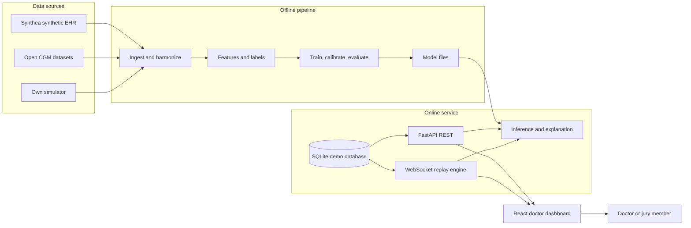
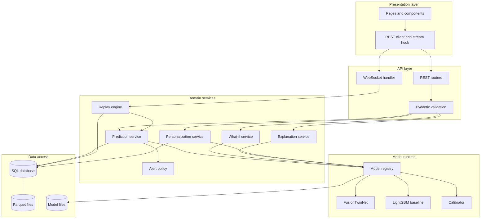
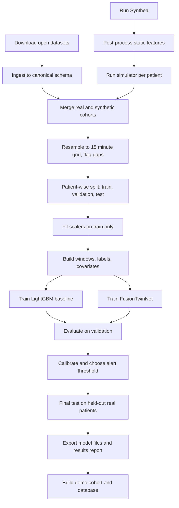
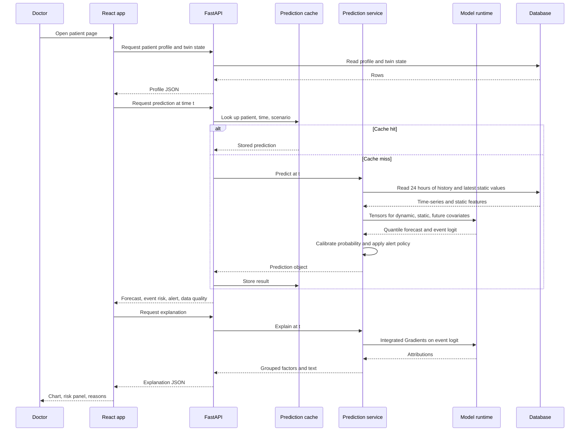
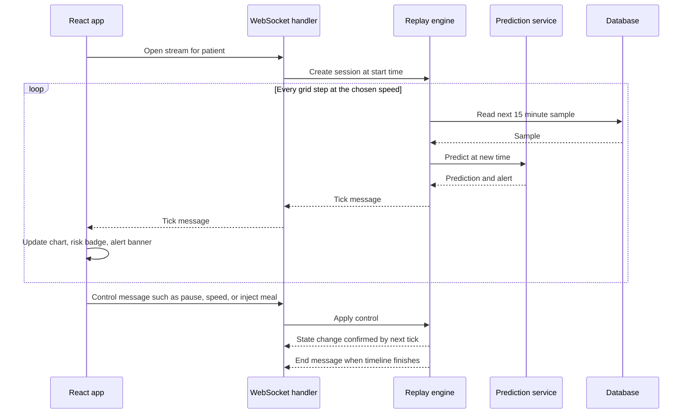
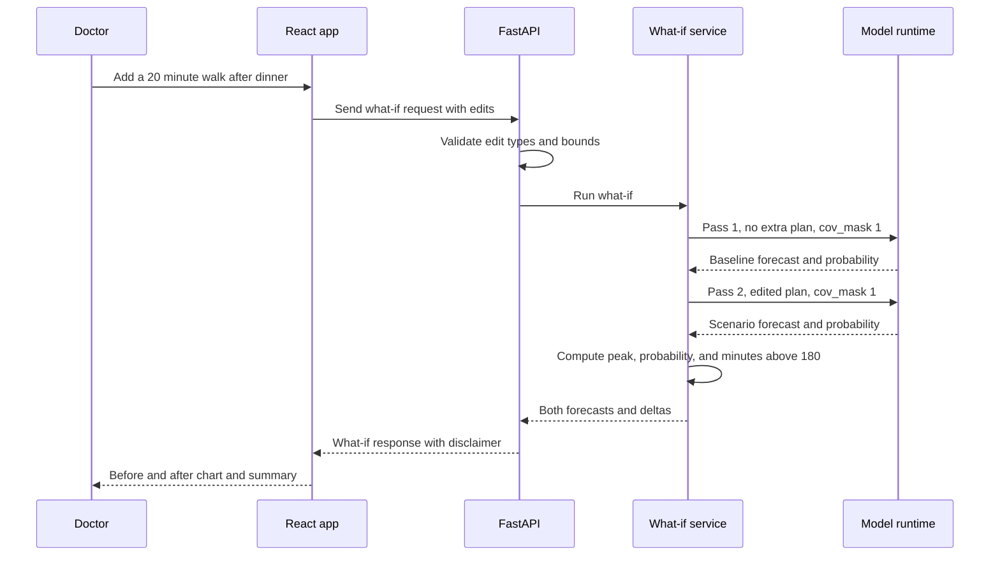
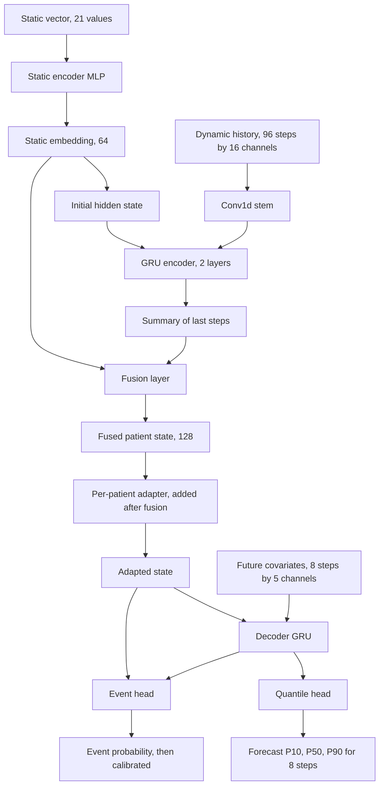
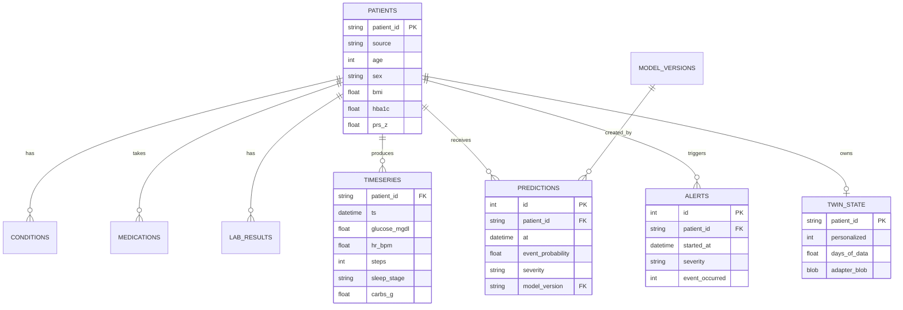
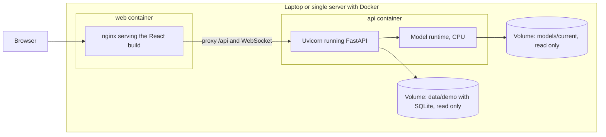

# Architecture

**Project:** GlucoTwin (working title)
**Related documents:** `PRD.md` (requirements), `TRD.md` (technical specification), `APP-FLOW.md` (screens and flows), `BACKEND-SCHEMA.md` (data contracts), `IMPLEMENTATION.md` (build guide)
**Version:** 1.0
**Date:** 2026-10-02

All diagrams use Mermaid, which GitHub renders directly in Markdown. Section 14 explains how to export them to PDF or PPT for the submission.

---

## 1. Purpose and scope

This document describes the structure of the system: the parts, how they connect, how data moves, and why the main choices were made. It does not repeat requirement detail from the PRD or tuning detail from the TRD.

**One sentence summary:** synthetic EHR data and wearable time-series are merged into one dataset, a two-branch neural network fuses them to forecast glucose and flag a hyperglycemic event up to 2 hours ahead, and a FastAPI service plus a React dashboard let a doctor inspect, question, and test the virtual patient.

## 2. System context



Two worlds exist side by side:

| World | When it runs | What it produces |
|---|---|---|
| Offline | Before the demo, on a laptop | A trained, calibrated model, metrics, and a demo cohort |
| Online | During the demo | Predictions, alerts, explanations, and what-if results served to the dashboard |

The online service never trains. It only loads files that the offline pipeline wrote.

## 3. Layered view



Rules that keep the layers clean:

1. The presentation layer talks only to the API layer, never to the database or model files.
2. Routers contain no business logic. They validate input, call one service, and shape the output.
3. Only the model registry touches model files. Services receive tensors and return plain Python objects.
4. Only the data access layer touches the database. The model code never imports SQLAlchemy.

## 4. Components

| Component | Responsibility | Key inputs | Key outputs | Spec |
|---|---|---|---|---|
| Ingestors | Read each open dataset and convert it to the canonical schema | Raw files | Canonical Parquet | TRD 4.1, 4.5 |
| Synthea post-processor | Turn Synthea CSV into static features with India-oriented adjustments | Synthea CSV | `static_features.parquet` | TRD 4.3 |
| Simulator | Generate glucose and wearable traces tied to the static profile | Static features | Time-series Parquet | TRD 4.4 |
| Feature and label builder | Build windows, scale features, create labels | Canonical Parquet | Training windows | TRD 4.6, 4.7 |
| Trainer | Train the baseline and `FusionTwinNet`, calibrate, export | Windows | Model files and metrics | TRD 5.2 to 5.4 |
| Evaluator | Compute metrics, ablations, lead time, plots | Test windows, model | `reports/results.md` | TRD 5.8 |
| Model registry | Load model, scaler, calibrator, metadata once at startup | `models/current/` | Ready-to-call predictor | TRD 6.1 |
| Prediction service | Build one window for a patient and time, run the model, apply calibration | Patient, time | Forecast and event probability | TRD 6.2 |
| Alert policy | Turn probability into severity, time to event, cool-down logic | Predictions over time | Alert state | TRD 5.4 |
| What-if service | Edit future covariates, run baseline and scenario passes | Edits | Two forecasts and deltas | TRD 5.6 |
| Explanation service | Integrated Gradients, grouped into readable factors | Window | Factor shares and text | TRD 5.7 |
| Personalization service | Fit and store the per-patient adapter | Patient history | `twin_state` row | TRD 5.5 |
| Replay engine | Walk a stored timeline at an accelerated speed and emit ticks | Patient, speed | WebSocket messages | TRD 6.3 |
| REST and WebSocket API | Expose everything to the dashboard | HTTP and WS requests | JSON | BACKEND-SCHEMA |
| Dashboard | Show patient list, live chart, risk, reasons, what-if | API | Visual interface | APP-FLOW |

## 5. Offline pipeline (training flow)



Key properties:

- The test split is created before any scaling or tuning, and it contains held-out real patients.
- Every step is a command in the Makefile, so the full chain can be repeated from a clean machine.
- Every artifact carries a data hash so a model can be traced back to the data it saw.

## 6. Online inference flow

A doctor opens a patient and the dashboard requests a prediction for the current simulated time.



## 7. Live replay flow

The replay engine makes stored data behave like a live wearable feed.



Design notes:

- The replay engine owns time. The browser never decides which sample comes next.
- If inference is slower than the tick interval, the engine skips ticks instead of building a queue, so the dashboard never falls behind.
- `inject_meal` writes an extra meal into the replayed session (not into the stored patient data) so the demo can show the twin reacting to something new.
- On a dropped connection the client reconnects with backoff and sends a `seek` to the last simulated time it received.

## 8. What-if flow



## 9. Model architecture



What makes this a fusion model and not two models glued together:

1. The static profile sets the starting state of the temporal encoder, so identical sensor traces are read differently for different patients.
2. The static embedding is also joined after the encoder, so it can adjust the final decision.
3. The fused state conditions both the forecast decoder and the event head.

What makes it behave like a twin:

1. A persistent fused state per patient, with an optional learned adapter.
2. Known-future covariates, so planned meals and activity can be changed and the future re-simulated.
3. Uncertainty bands, so the twin shows how sure it is.

## 10. Data model overview

The full definition is in `BACKEND-SCHEMA.md`. This diagram shows the relationships.



## 11. Deployment view



Notes:

- No outbound internet access is needed at demo time.
- The `trainer` container is optional and runs only when reproducing training.
- For a hosted demo, put the same two containers on any small server and add HTTPS at the proxy.

## 12. Key design decisions

The full decision log is in `TRD.md` section 14. The ones that shape the architecture:

| Decision | Reason | Trade-off |
|---|---|---|
| Separate offline and online worlds | Training is slow and the demo must be fast and safe | Model changes need a re-export |
| Replay engine instead of real device ingestion | Reproducible, safe, works offline | Not a true live feed |
| One shared model runtime inside the API process | Simple, low latency, no network hop | Scaling needs one process per worker |
| Calibration outside the network | Probabilities can be refit without retraining | One more artifact to version |
| Explanation by grouped Integrated Gradients | Doctors read factors, not 1,500 raw features | Grouping choices must be documented |
| SQLite for the demo cohort | No setup, easy to ship in the repository | Not for concurrent heavy writes |
| Typed contracts shared with the frontend through OpenAPI | Fewer integration bugs | Need to regenerate types after API changes |

## 13. Cross-cutting concerns

### 13.1 Reliability and degradation

| Failure | Behavior |
|---|---|
| Model files missing or invalid | API starts but `/health` reports degraded. Prediction endpoints return 503. The dashboard shows a clear message. |
| Glucose data missing for more than 40 percent of the window | Prediction is returned with `low_confidence = true` and the alert is suppressed. |
| Static features outside the training range | Same low confidence behavior and a note in the explanation. |
| Inference slower than the tick interval | Replay skips ticks. |
| WebSocket disconnect | Client reconnects with backoff and resumes from the last simulated time. |
| Database file locked or unreadable | API returns 503 with a retry hint. |
| Explanation too slow | Fall back to group occlusion. |

### 13.2 Observability

- Structured JSON logs with request ID, patient ID (synthetic), endpoint, latency, model version.
- A `/health` endpoint that reports model version, database status, and cache size.
- Latency numbers for predict, explain, and what-if are logged so the performance budget can be checked.
- No logging of anything that could be personal data (the system has none, but the habit matters).

### 13.3 Configuration

All tunable values live in `configs/default.yaml` and environment variables prefixed `GT_`. No magic numbers in code. The model metadata file records the configuration used at training time.

### 13.4 Security and privacy

- Synthetic or open anonymized data only.
- Input validation on every request with explicit bounds.
- CORS limited to the dashboard origin.
- No secrets in the repository.

### 13.5 Clinical safety

- A non-dismissable prototype banner on every page.
- No treatment, dose, or diet advice anywhere.
- What-if outputs labeled as model estimates.
- Low confidence handling as described above.

## 14. Extension path

| Direction | What changes |
|---|---|
| Another condition, such as hypertension | Replace the event definition, the dynamic channels (blood pressure, heart rate variability), and the static feature list. The layers, API shape, and dashboard pattern stay the same. |
| Real wearable feed | Replace the replay engine input with an ingestion service reading from a device API or Health Connect, and add authentication and consent. |
| Real EHR | Replace the synthetic loader with a FHIR reader and add privacy controls, audit logs, and encryption. |
| More patients | Move SQLite to PostgreSQL, run several API workers, and move the cache to Redis. |
| Better physiology | Blend a mechanistic glucose model with the learned model (hybrid twin). |

## 15. Exporting diagrams for the submission

The challenge requires an architecture diagram as PDF or PPT. Two simple routes:

**Route A: Mermaid CLI**

```bash
npm install -g @mermaid-js/mermaid-cli

# save one diagram block, for example the system context, as docs/diagrams/system.mmd
mmdc -i docs/diagrams/system.mmd -o docs/diagrams/system.pdf
mmdc -i docs/diagrams/layers.mmd -o docs/diagrams/layers.pdf

# or render every diagram in this file to images
mmdc -i docs/ARCHITECTURE.md -o docs/ARCHITECTURE.rendered.md
```

Merge the PDFs into one file (`architecture.pdf`) with any PDF tool and add a title page and a legend.

**Route B: draw.io**

In draw.io, use Arrange, Insert, Advanced, Mermaid to paste a diagram, then restyle it and export as PDF. Use this route if you want a more polished slide-ready look.

Recommended contents of the submitted diagram file:

1. Page 1: system context (section 2) and layered view (section 3).
2. Page 2: offline pipeline (section 5).
3. Page 3: model architecture (section 9).
4. Page 4: online inference and replay flows (sections 6 and 7).

Keep the same names and colors in the slides and the video so judges can follow along.
