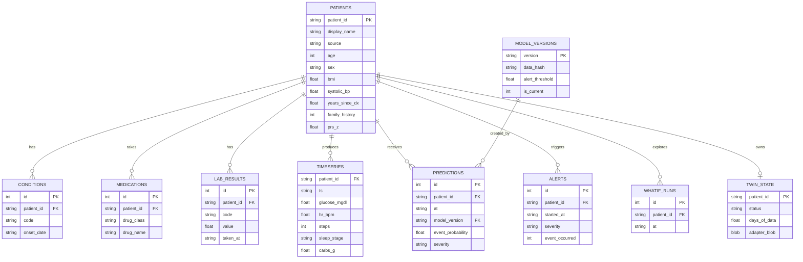

# Backend Schema

**Project:** GlucoTwin (working title)
**Related documents:** `TRD.md`, `ARCHITECTURE.md`, `APP-FLOW.md`, `IMPLEMENTATION.md`
**Version:** 1.0
**Date:** 2026-10-02

This is the detailed data contract for the backend: the database, the API request and response models, the WebSocket messages, the Parquet files used for training, and the model artifact files. Where this file and TRD section 7 differ, **this file wins** (for example, lab values live in their own table here).

---

## 1. Conventions

| Topic | Rule |
|---|---|
| Naming | `snake_case` for tables, columns, JSON keys, and Python fields |
| Identifiers | Text IDs with a source prefix: `cgm_` (CGMacros), `big_` (BIG IDEAs), `sha_` (Shanghai), `syn_` (Synthea plus simulator) |
| Timestamps | ISO 8601 text without a time zone, for example `2026-03-14T19:45:00`. They represent simulated local time. Text in this format sorts correctly. |
| Time grid | All time-series rows sit on the 15 minute grid (`grid_minutes`) |
| Units | Glucose in mg/dL, heart rate in beats per minute, steps per interval, carbohydrates in grams |
| Booleans in SQLite | Integers 0 or 1 |
| Missing values | `NULL` in the database, `null` in JSON, `NaN` in Parquet |
| Synthetic marking | Every patient has a `source` column. Synthetic-only fields (such as `prs_z`) have an explicit flag. |
| Versioning | API under `/api/v1`. Model files carry a semantic version. |

## 2. Storage map

| What | Where | Why |
|---|---|---|
| Training data (all patients, full history) | Parquet files in `data/processed/` | Fast columnar reads, not needed by the live service |
| Demo cohort (about 5 patients) | SQLite database `data/demo/demo.db` | Served by the API during the demo |
| Model, scaler, calibrator, metadata | Files in `models/current/` | Loaded once at startup |
| Per-patient adapter | `twin_state.adapter_blob` in the database | Changes at runtime |
| Prediction cache | In memory (LRU) | Fast repeats during replay |
| Replay sessions | In memory | Short lived, one per WebSocket |
| Reports and figures | `reports/` | Generated by `make evaluate` |

## 3. Enumerations

| Name | Values |
|---|---|
| `source` | `real_open`, `synthetic` |
| `sex` | `F`, `M` |
| `sleep_stage` | `awake`, `light`, `deep`, `rem` |
| `severity` | `low`, `moderate`, `high` |
| `trend` | `rising`, `flat`, `falling` |
| `twin_status` | `not_personalized`, `collecting`, `personalized`, `stale` |
| `drug_class` | `metformin`, `sulfonylurea`, `dpp4`, `sglt2`, `insulin`, `other` |
| `condition_code` | `type2_diabetes`, `prediabetes`, `hypertension`, `dyslipidemia`, `ckd`, `obesity`, `other` |
| `lab_code` | `hba1c`, `fasting_glucose`, `egfr` |
| `edit_type` | `meal`, `skip_meal`, `activity` |
| `replay_speed` | `60`, `300`, `900` |

Trend rule: compare the current glucose with the value 30 minutes earlier. Rising if the change is above +10 mg/dL, falling if below -10 mg/dL, flat otherwise.

## 4. Relational schema (SQLite, PostgreSQL compatible)

```sql
PRAGMA foreign_keys = ON;

-- 4.1 Model versions -------------------------------------------------------
CREATE TABLE model_versions (
  version        TEXT PRIMARY KEY,                 -- for example 0.1.0
  created_at     TEXT NOT NULL,
  data_hash      TEXT NOT NULL,
  config_json    TEXT NOT NULL,
  metrics_json   TEXT NOT NULL,
  alert_threshold REAL NOT NULL CHECK (alert_threshold BETWEEN 0 AND 1),
  is_current     INTEGER NOT NULL DEFAULT 0 CHECK (is_current IN (0,1))
);

-- 4.2 Patients -------------------------------------------------------------
CREATE TABLE patients (
  patient_id       TEXT PRIMARY KEY,
  display_name     TEXT NOT NULL,                  -- fictional name for the demo
  source           TEXT NOT NULL CHECK (source IN ('real_open','synthetic')),
  source_dataset   TEXT,                           -- cgmacros, bigideas, shanghai, synthea_sim
  age              INTEGER NOT NULL CHECK (age BETWEEN 18 AND 100),
  sex              TEXT NOT NULL CHECK (sex IN ('F','M')),
  bmi              REAL CHECK (bmi BETWEEN 12 AND 70),
  systolic_bp      REAL CHECK (systolic_bp BETWEEN 70 AND 260),
  years_since_dx   REAL CHECK (years_since_dx >= 0),
  family_history   INTEGER CHECK (family_history IN (0,1)),
  prs_z            REAL,                           -- synthetic polygenic risk score
  prs_is_synthetic INTEGER NOT NULL DEFAULT 1 CHECK (prs_is_synthetic IN (0,1)),
  timeline_start   TEXT NOT NULL,
  timeline_end     TEXT NOT NULL,
  created_at       TEXT NOT NULL DEFAULT CURRENT_TIMESTAMP
);

-- 4.3 EHR tables -----------------------------------------------------------
CREATE TABLE conditions (
  id          INTEGER PRIMARY KEY AUTOINCREMENT,
  patient_id  TEXT NOT NULL REFERENCES patients(patient_id) ON DELETE CASCADE,
  code        TEXT NOT NULL CHECK (code IN
              ('type2_diabetes','prediabetes','hypertension','dyslipidemia','ckd','obesity','other')),
  name        TEXT NOT NULL,
  onset_date  TEXT
);
CREATE INDEX ix_conditions_patient ON conditions(patient_id);

CREATE TABLE medications (
  id          INTEGER PRIMARY KEY AUTOINCREMENT,
  patient_id  TEXT NOT NULL REFERENCES patients(patient_id) ON DELETE CASCADE,
  drug_class  TEXT NOT NULL CHECK (drug_class IN
              ('metformin','sulfonylurea','dpp4','sglt2','insulin','other')),
  drug_name   TEXT NOT NULL,
  start_date  TEXT,
  end_date    TEXT                                  -- NULL means ongoing
);
CREATE INDEX ix_meds_patient ON medications(patient_id);

CREATE TABLE lab_results (
  id          INTEGER PRIMARY KEY AUTOINCREMENT,
  patient_id  TEXT NOT NULL REFERENCES patients(patient_id) ON DELETE CASCADE,
  code        TEXT NOT NULL CHECK (code IN ('hba1c','fasting_glucose','egfr')),
  value       REAL NOT NULL,
  unit        TEXT NOT NULL,                        -- %, mg/dL, mL/min/1.73m2
  taken_at    TEXT NOT NULL
);
CREATE INDEX ix_labs_patient_code_time ON lab_results(patient_id, code, taken_at);

-- 4.4 Sensor time-series ---------------------------------------------------
CREATE TABLE timeseries (
  patient_id           TEXT NOT NULL REFERENCES patients(patient_id) ON DELETE CASCADE,
  ts                   TEXT NOT NULL,
  glucose_mgdl         REAL CHECK (glucose_mgdl IS NULL OR glucose_mgdl BETWEEN 40 AND 500),
  glucose_interpolated INTEGER NOT NULL DEFAULT 0 CHECK (glucose_interpolated IN (0,1)),
  hr_bpm               REAL CHECK (hr_bpm IS NULL OR hr_bpm BETWEEN 30 AND 220),
  steps                INTEGER CHECK (steps IS NULL OR steps >= 0),
  sleep_stage          TEXT CHECK (sleep_stage IS NULL OR sleep_stage IN ('awake','light','deep','rem')),
  carbs_g              REAL NOT NULL DEFAULT 0 CHECK (carbs_g >= 0),
  PRIMARY KEY (patient_id, ts)
) WITHOUT ROWID;

-- 4.5 Predictions, alerts, twin state, what-if log -----------------------------
CREATE TABLE predictions (
  id                   INTEGER PRIMARY KEY AUTOINCREMENT,
  patient_id           TEXT NOT NULL REFERENCES patients(patient_id) ON DELETE CASCADE,
  at                   TEXT NOT NULL,
  model_version        TEXT NOT NULL REFERENCES model_versions(version),
  personalized         INTEGER NOT NULL DEFAULT 0 CHECK (personalized IN (0,1)),
  raw_probability      REAL NOT NULL CHECK (raw_probability BETWEEN 0 AND 1),
  event_probability    REAL NOT NULL CHECK (event_probability BETWEEN 0 AND 1),
  severity             TEXT NOT NULL CHECK (severity IN ('low','moderate','high')),
  low_confidence       INTEGER NOT NULL DEFAULT 0 CHECK (low_confidence IN (0,1)),
  est_minutes_to_event INTEGER CHECK (est_minutes_to_event IS NULL OR est_minutes_to_event BETWEEN 0 AND 120),
  forecast_json        TEXT NOT NULL,
  created_at           TEXT NOT NULL DEFAULT CURRENT_TIMESTAMP
);
CREATE UNIQUE INDEX ux_predictions_key
  ON predictions(patient_id, at, model_version, personalized);

CREATE TABLE alerts (
  id               INTEGER PRIMARY KEY AUTOINCREMENT,
  patient_id       TEXT NOT NULL REFERENCES patients(patient_id) ON DELETE CASCADE,
  started_at       TEXT NOT NULL,
  ended_at         TEXT,
  severity         TEXT NOT NULL CHECK (severity IN ('low','moderate','high')),
  peak_probability REAL NOT NULL CHECK (peak_probability BETWEEN 0 AND 1),
  event_onset_at   TEXT,                            -- filled when the outcome is known
  event_occurred   INTEGER CHECK (event_occurred IS NULL OR event_occurred IN (0,1)),
  lead_time_min    INTEGER CHECK (lead_time_min IS NULL OR lead_time_min >= 0)
);
CREATE INDEX ix_alerts_patient_time ON alerts(patient_id, started_at);

CREATE TABLE twin_state (
  patient_id      TEXT PRIMARY KEY REFERENCES patients(patient_id) ON DELETE CASCADE,
  status          TEXT NOT NULL DEFAULT 'not_personalized'
                  CHECK (status IN ('not_personalized','collecting','personalized','stale')),
  days_of_data    REAL NOT NULL DEFAULT 0 CHECK (days_of_data >= 0),
  adapter_blob    BLOB,                             -- see section 11.4
  adapter_version TEXT,
  fitted_at       TEXT,
  rmse_before     REAL,
  rmse_after      REAL,
  updated_at      TEXT NOT NULL DEFAULT CURRENT_TIMESTAMP
);

CREATE TABLE whatif_runs (                          -- optional, helps the demo history list
  id            INTEGER PRIMARY KEY AUTOINCREMENT,
  patient_id    TEXT NOT NULL REFERENCES patients(patient_id) ON DELETE CASCADE,
  at            TEXT NOT NULL,
  edits_json    TEXT NOT NULL,
  baseline_json TEXT NOT NULL,
  scenario_json TEXT NOT NULL,
  created_at    TEXT NOT NULL DEFAULT CURRENT_TIMESTAMP
);
CREATE INDEX ix_whatif_patient ON whatif_runs(patient_id, created_at);
```

### 4.1 Entity relationship diagram



## 5. Data dictionary (key fields)

| Table.column | Meaning | Notes |
|---|---|---|
| `patients.source` | Whether the person comes from a real open dataset or is synthetic | Drives the "real open" or "synthetic" label in the UI |
| `patients.prs_z` | Polygenic risk score, standardized | Always synthetic (`prs_is_synthetic = 1`) |
| `lab_results.code` | Lab type | Latest value before the prediction time feeds the static vector |
| `timeseries.glucose_interpolated` | 1 if the value came from gap filling | Counts toward data quality, never toward labels for evaluation |
| `timeseries.carbs_g` | Carbohydrates logged at a meal in this interval | 0 when no meal |
| `predictions.raw_probability` | Network output after sigmoid, before calibration | Stored for calibration audits |
| `predictions.event_probability` | Calibrated probability | What the dashboard shows |
| `predictions.forecast_json` | The 8 forecast points | Same shape as the API `forecast` list |
| `alerts.lead_time_min` | Minutes between alert start and event onset | Only for alerts that were followed by an event |
| `twin_state.status` | Personalization status | Maintained by the personalization service |
| `model_versions.alert_threshold` | Threshold chosen on validation | Used by the alert policy |

## 6. Useful queries

**History window for a prediction at time `t` (96 rows when the data is complete):**

```sql
SELECT ts, glucose_mgdl, glucose_interpolated, hr_bpm, steps, sleep_stage, carbs_g
FROM timeseries
WHERE patient_id = :pid
  AND ts >  :t_minus_24h
  AND ts <= :t
ORDER BY ts;
```

**Latest lab values known at time `t` (prevents using the future):**

```sql
SELECT l.code, l.value
FROM lab_results l
JOIN (
  SELECT code, MAX(taken_at) AS mt
  FROM lab_results
  WHERE patient_id = :pid AND taken_at <= :t
  GROUP BY code
) m ON l.code = m.code AND l.taken_at = m.mt
WHERE l.patient_id = :pid;
```

**Medicines active at time `t`:**

```sql
SELECT drug_class
FROM medications
WHERE patient_id = :pid
  AND (start_date IS NULL OR start_date <= :t)
  AND (end_date   IS NULL OR end_date   >  :t);
```

**Patient list with current state (one pass, used by `GET /patients`):**

```sql
SELECT p.patient_id, p.display_name, p.age, p.sex,
       ts.status AS twin_status,
       pr.event_probability, pr.severity, pr.low_confidence, pr.est_minutes_to_event, pr.at
FROM patients p
LEFT JOIN twin_state ts ON ts.patient_id = p.patient_id
LEFT JOIN predictions pr ON pr.id = (
  SELECT id FROM predictions
  WHERE patient_id = p.patient_id
  ORDER BY at DESC LIMIT 1
);
```

## 7. SQLAlchemy models (pattern)

```python
from sqlalchemy import ForeignKey, String, Float, Integer, LargeBinary
from sqlalchemy.orm import DeclarativeBase, Mapped, mapped_column, relationship


class Base(DeclarativeBase):
    pass


class Patient(Base):
    __tablename__ = "patients"

    patient_id: Mapped[str] = mapped_column(String, primary_key=True)
    display_name: Mapped[str] = mapped_column(String)
    source: Mapped[str] = mapped_column(String)
    age: Mapped[int] = mapped_column(Integer)
    sex: Mapped[str] = mapped_column(String)
    bmi: Mapped[float | None] = mapped_column(Float, nullable=True)
    prs_z: Mapped[float | None] = mapped_column(Float, nullable=True)

    twin_state: Mapped["TwinState | None"] = relationship(back_populates="patient", uselist=False)


class TwinState(Base):
    __tablename__ = "twin_state"

    patient_id: Mapped[str] = mapped_column(ForeignKey("patients.patient_id"), primary_key=True)
    status: Mapped[str] = mapped_column(String, default="not_personalized")
    days_of_data: Mapped[float] = mapped_column(Float, default=0.0)
    adapter_blob: Mapped[bytes | None] = mapped_column(LargeBinary, nullable=True)

    patient: Mapped[Patient] = relationship(back_populates="twin_state")
```

Use the same pattern for the other tables. Keep SQLAlchemy models in `service/db.py` and never import them from model code.

## 8. Model input contract

These lists are the single source of truth for column order. They live in `gluco_twin/config.py` as constants and are saved into `meta.json`, so a model can never be run with the wrong order.

### 8.1 Dynamic channels (16), history window of 96 steps

| Index | Name | Source | Transform | Missing handling |
|---|---|---|---|---|
| 0 | `glucose_z` | `glucose_mgdl` | z-score | Forward fill, then mask |
| 1 | `glucose_diff` | derived | one-step difference, scaled | 0 and mask |
| 2 | `hr_z` | `hr_bpm` | z-score | 0 and mask |
| 3 | `steps_z` | `steps` | log1p then z-score | 0 and mask |
| 4 | `sleep_awake` | `sleep_stage` | one-hot | all zero when unknown |
| 5 | `sleep_light` | `sleep_stage` | one-hot | all zero when unknown |
| 6 | `sleep_deep` | `sleep_stage` | one-hot | all zero when unknown |
| 7 | `sleep_rem` | `sleep_stage` | one-hot | all zero when unknown |
| 8 | `carbs_z` | `carbs_g` | scale by training standard deviation | 0 |
| 9 | `since_meal_z` | derived | minutes since last meal, clipped at 360, scaled | 360 when no meal in window |
| 10 | `tod_sin` | `ts` | sine of time of day | never missing |
| 11 | `tod_cos` | `ts` | cosine of time of day | never missing |
| 12 | `mask_glucose` | derived | 1 if observed | n/a |
| 13 | `mask_hr` | derived | 1 if observed | n/a |
| 14 | `mask_steps` | derived | 1 if observed | n/a |
| 15 | `mask_sleep` | derived | 1 if observed | n/a |

### 8.2 Future covariates (5), horizon of 8 steps

| Index | Name | Notes |
|---|---|---|
| 0 | `plan_carbs_z` | Planned meal size at that step, 0 if none |
| 1 | `plan_steps_z` | Planned activity at that step, 0 if none |
| 2 | `tod_sin` | Always known |
| 3 | `tod_cos` | Always known |
| 4 | `cov_mask` | 1 if plan values are given, 0 if unknown |

### 8.3 Static vector (21)

| Index | Name | Source | Transform | Missing handling |
|---|---|---|---|---|
| 0 | `age_z` | `patients.age` | z-score | required |
| 1 | `sex_male` | `patients.sex` | 1 for M, 0 for F | required |
| 2 | `bmi_z` | `patients.bmi` | z-score | median |
| 3 | `sbp_z` | `patients.systolic_bp` | z-score | median |
| 4 | `hba1c_z` | latest `hba1c` lab | z-score | median plus flag 18 |
| 5 | `fasting_glucose_z` | latest `fasting_glucose` lab | z-score | median plus flag 19 |
| 6 | `egfr_z` | latest `egfr` lab | z-score | median plus flag 20 |
| 7 | `years_dx_z` | `patients.years_since_dx` | z-score | median |
| 8 | `med_metformin` | active medicines | 0 or 1 | 0 |
| 9 | `med_sulfonylurea` | active medicines | 0 or 1 | 0 |
| 10 | `med_dpp4` | active medicines | 0 or 1 | 0 |
| 11 | `med_sglt2` | active medicines | 0 or 1 | 0 |
| 12 | `med_insulin` | active medicines | 0 or 1 | 0 |
| 13 | `cond_hypertension` | `conditions` | 0 or 1 | 0 |
| 14 | `cond_dyslipidemia` | `conditions` | 0 or 1 | 0 |
| 15 | `cond_ckd` | `conditions` | 0 or 1 | 0 |
| 16 | `family_history` | `patients.family_history` | 0 or 1 | 0 |
| 17 | `prs_z` | `patients.prs_z` | already standardized | 0 |
| 18 | `miss_hba1c` | derived | 1 if imputed | n/a |
| 19 | `miss_fasting_glucose` | derived | 1 if imputed | n/a |
| 20 | `miss_egfr` | derived | 1 if imputed | n/a |

## 9. API schemas (Pydantic v2)

These classes live in `gluco_twin/service/schemas.py`. FastAPI generates the OpenAPI document from them, and the frontend generates its TypeScript types from that document.

```python
from datetime import datetime
from typing import Annotated, Literal, Union

from pydantic import BaseModel, ConfigDict, Field

Severity = Literal["low", "moderate", "high"]
TwinStatus = Literal["not_personalized", "collecting", "personalized", "stale"]
Trend = Literal["rising", "flat", "falling"]
Sex = Literal["F", "M"]


class ApiModel(BaseModel):
    model_config = ConfigDict(extra="forbid")


# ---------- Patients ----------
class PatientSummary(ApiModel):
    patient_id: str
    display_name: str
    age: int
    sex: Sex
    source: Literal["real_open", "synthetic"]
    current_glucose_mgdl: float | None
    trend: Trend | None
    risk: Severity | None
    low_confidence: bool
    minutes_to_event: int | None
    twin_status: TwinStatus
    last_update: datetime | None


class Condition(ApiModel):
    code: str
    name: str
    onset_date: str | None


class Medication(ApiModel):
    drug_class: str
    drug_name: str


class LabValue(ApiModel):
    code: Literal["hba1c", "fasting_glucose", "egfr"]
    value: float
    unit: str
    taken_at: datetime


class TwinStateOut(ApiModel):
    status: TwinStatus
    days_of_data: float
    fitted_at: datetime | None
    rmse_before: float | None
    rmse_after: float | None


class PatientDetail(PatientSummary):
    bmi: float | None
    systolic_bp: float | None
    years_since_dx: float | None
    family_history: bool | None
    prs_z: float | None
    prs_is_synthetic: bool
    conditions: list[Condition]
    medications: list[Medication]
    labs: list[LabValue]
    twin: TwinStateOut
    timeline_start: datetime
    timeline_end: datetime


# ---------- Prediction ----------
class ForecastPoint(ApiModel):
    offset_min: Annotated[int, Field(ge=15, le=120, multiple_of=15)]
    p10: float
    p50: float
    p90: float


class EventPrediction(ApiModel):
    probability: Annotated[float, Field(ge=0, le=1)]
    severity: Severity
    estimated_minutes_to_event: int | None
    threshold_mgdl: int


class AlertState(ApiModel):
    active: bool
    severity: Severity | None
    since: datetime | None


class DataQuality(ApiModel):
    glucose: Annotated[float, Field(ge=0, le=1)]
    hr: Annotated[float, Field(ge=0, le=1)]
    steps: Annotated[float, Field(ge=0, le=1)]
    sleep: Annotated[float, Field(ge=0, le=1)]
    last_update_s: int | None


class PredictRequest(ApiModel):
    at: datetime
    use_personalization: bool = True


class PredictResponse(ApiModel):
    patient_id: str
    at: datetime
    current_glucose_mgdl: float | None
    forecast: list[ForecastPoint]            # 8 points, offsets 15 to 120
    event: EventPrediction
    alert: AlertState
    low_confidence: bool
    personalized: bool
    data_quality: DataQuality
    model_version: str


# ---------- What-if ----------
class MealEdit(ApiModel):
    type: Literal["meal"]
    start_offset_min: Annotated[int, Field(ge=0, le=105, multiple_of=15)]
    carbs_g: Annotated[float, Field(ge=0, le=200)]


class SkipMealEdit(ApiModel):
    type: Literal["skip_meal"]
    start_offset_min: Annotated[int, Field(ge=0, le=105, multiple_of=15)]


class ActivityEdit(ApiModel):
    type: Literal["activity"]
    start_offset_min: Annotated[int, Field(ge=0, le=105, multiple_of=15)]
    duration_min: Annotated[int, Field(ge=10, le=60, multiple_of=5)]
    steps_per_15min: Annotated[int, Field(ge=0, le=3000)]


Edit = Annotated[Union[MealEdit, SkipMealEdit, ActivityEdit], Field(discriminator="type")]


class WhatIfRequest(ApiModel):
    at: datetime
    edits: Annotated[list[Edit], Field(min_length=1, max_length=5)]


class ScenarioSummary(ApiModel):
    peak_mgdl: float
    event_probability: Annotated[float, Field(ge=0, le=1)]
    minutes_above_180: int


class WhatIfResponse(ApiModel):
    baseline: ScenarioSummary
    scenario: ScenarioSummary
    baseline_forecast: list[ForecastPoint]
    scenario_forecast: list[ForecastPoint]
    summary_text: str
    disclaimer: str = "Model estimate for exploration, not medical advice."


# ---------- Explanation ----------
class ExplainFactor(ApiModel):
    name: str
    share: Annotated[float, Field(ge=0, le=1)]
    direction: Literal["raises", "lowers"]


class ExplainResponse(ApiModel):
    at: datetime
    factors: list[ExplainFactor]             # sorted by share, at most 5 shown
    text: str
    method: Literal["integrated_gradients", "occlusion"]


# ---------- Personalization and alerts ----------
class PersonalizeResponse(ApiModel):
    status: TwinStatus
    days_of_data: float
    rmse_before: float | None
    rmse_after: float | None


class AlertRecord(ApiModel):
    id: int
    started_at: datetime
    ended_at: datetime | None
    severity: Severity
    peak_probability: float
    event_occurred: bool | None
    lead_time_min: int | None


# ---------- Timeseries ----------
class TimeseriesPoint(ApiModel):
    ts: datetime
    glucose_mgdl: float | None
    hr_bpm: float | None
    steps: int | None
    sleep_stage: Literal["awake", "light", "deep", "rem"] | None
    carbs_g: float


class TimeseriesResponse(ApiModel):
    patient_id: str
    points: list[TimeseriesPoint]


# ---------- Model info and health ----------
class ModelInfo(ApiModel):
    version: str
    created_at: datetime
    data_hash: str
    alert_threshold: float
    metrics: dict[str, float | dict[str, float]]
    datasets: list[dict[str, str]]           # name, type, license, role
    limitations: list[str]


class Health(ApiModel):
    status: Literal["ok", "degraded"]
    model_version: str | None
    database: Literal["ok", "unavailable"]
    cache_entries: int


# ---------- Errors ----------
class ErrorDetail(ApiModel):
    code: str
    message: str
    details: dict | None = None


class ErrorBody(ApiModel):
    error: ErrorDetail
```

## 10. WebSocket schemas

Endpoint: `WS /api/v1/patients/{patient_id}/stream?start=2026-03-14T08:00:00&speed=900`

```python
from typing import Annotated, Literal, Union
from pydantic import Field


# ----- Server to client -----
class Sample(ApiModel):
    glucose: float | None
    hr: float | None
    steps: int | None
    sleep_stage: Literal["awake", "light", "deep", "rem"] | None
    carbs_g: float


class TickMessage(ApiModel):
    type: Literal["tick"]
    seq: int                                 # increases by 1 per tick
    sim_time: datetime
    speed: Literal[60, 300, 900]
    sample: Sample
    prediction: PredictResponse
    skipped_ticks: int = 0                   # ticks dropped because inference was slow


class StateMessage(ApiModel):
    type: Literal["state"]
    state: Literal["paused", "playing", "ended"]
    sim_time: datetime


class HeartbeatMessage(ApiModel):
    type: Literal["heartbeat"]
    server_time: datetime


class EndMessage(ApiModel):
    type: Literal["end"]


class StreamError(ApiModel):
    type: Literal["error"]
    error: ErrorDetail


# ----- Client to server -----
class PlayControl(ApiModel):
    type: Literal["control"]
    action: Literal["play"]


class PauseControl(ApiModel):
    type: Literal["control"]
    action: Literal["pause"]


class SeekControl(ApiModel):
    type: Literal["control"]
    action: Literal["seek"]
    value: datetime


class SpeedControl(ApiModel):
    type: Literal["control"]
    action: Literal["speed"]
    value: Literal[60, 300, 900]


class InjectMealControl(ApiModel):
    type: Literal["control"]
    action: Literal["inject_meal"]
    carbs_g: Annotated[float, Field(ge=0, le=200)]


ClientMessage = Annotated[
    Union[PlayControl, PauseControl, SeekControl, SpeedControl, InjectMealControl],
    Field(discriminator="action"),
]
```

Rules:

- The first message from the server after connecting is a `state` message with state `paused`.
- A `tick` is only sent while playing.
- A heartbeat is sent every 10 seconds, also while paused.
- `seek` must fall inside `[timeline_start + 24 hours, timeline_end]`. Otherwise the server sends an `error` message and keeps the session.
- Invalid client messages produce an `error` message, never a closed socket, unless the same client sends more than 20 invalid messages in a minute.

**WebSocket close codes:**

| Code | Meaning |
|---|---|
| 1000 | Normal close |
| 1011 | Internal server error |
| 4404 | Patient not found |
| 4409 | Not enough history for this patient |
| 4503 | Model unavailable |

## 11. File formats

### 11.1 Parquet files (training side)

**`data/processed/static_features.parquet`** (one row per patient)

| Column | Type | Notes |
|---|---|---|
| `patient_id` | string | Primary key |
| `source` | string | `real_open` or `synthetic` |
| `source_dataset` | string | |
| `age`, `bmi`, `systolic_bp`, `years_since_dx` | float | |
| `sex` | string | `F` or `M` |
| `hba1c`, `fasting_glucose`, `egfr` | float | Latest value, nullable |
| `med_metformin`, `med_sulfonylurea`, `med_dpp4`, `med_sglt2`, `med_insulin` | int8 | |
| `cond_hypertension`, `cond_dyslipidemia`, `cond_ckd` | int8 | |
| `family_history` | int8 | |
| `prs_z` | float | Synthetic |
| `split` | string | `train`, `val`, `test_real`, `test_synth` |

**`data/processed/timeseries_grid.parquet`** (one row per patient per 15 minute step)

| Column | Type | Notes |
|---|---|---|
| `patient_id` | string | |
| `ts` | timestamp[ns] | |
| `glucose_mgdl` | float32 | NaN when missing |
| `glucose_interpolated` | int8 | |
| `hr_bpm` | float32 | |
| `steps` | float32 | |
| `sleep_stage` | string | nullable |
| `carbs_g` | float32 | Default 0 |

**`data/processed/windows_index.parquet`** (one row per usable prediction time)

| Column | Type | Notes |
|---|---|---|
| `patient_id` | string | |
| `t` | timestamp[ns] | Prediction time |
| `split` | string | Copied from the patient |
| `y_event` | int8 | Event starts within 120 minutes |
| `already_high` | bool | Excluded from classification metrics |
| `event_onset_offset_min` | float32 | Null if no event |
| `y_g30`, `y_g60`, `y_g120` | float32 | Targets |
| `y_path_0` to `y_path_7` | float32 | Full 8-step path |
| `future_missing_frac` | float32 | Rows above 0.25 are dropped |

Window tensors are built on the fly from `timeseries_grid.parquet` using this index. This keeps the files small.

### 11.2 `models/current/meta.json`

```json
{
  "version": "0.1.0",
  "created_at": "2026-10-20T10:15:00",
  "data_hash": "sha256:9f2c...",
  "grid_minutes": 15,
  "history_steps": 96,
  "horizon_steps": 8,
  "event": { "threshold_mgdl": 180, "min_run_steps": 3 },
  "dynamic_channels": ["glucose_z", "glucose_diff", "hr_z", "steps_z", "sleep_awake", "sleep_light", "sleep_deep", "sleep_rem", "carbs_z", "since_meal_z", "tod_sin", "tod_cos", "mask_glucose", "mask_hr", "mask_steps", "mask_sleep"],
  "future_channels": ["plan_carbs_z", "plan_steps_z", "tod_sin", "tod_cos", "cov_mask"],
  "static_features": ["age_z", "sex_male", "bmi_z", "sbp_z", "hba1c_z", "fasting_glucose_z", "egfr_z", "years_dx_z", "med_metformin", "med_sulfonylurea", "med_dpp4", "med_sglt2", "med_insulin", "cond_hypertension", "cond_dyslipidemia", "cond_ckd", "family_history", "prs_z", "miss_hba1c", "miss_fasting_glucose", "miss_egfr"],
  "alert_threshold": 0.52,
  "severity_cutoffs": { "moderate": 0.30, "high": 0.60 },
  "metrics": {
    "test_real": { "auroc": null, "auprc": null, "rmse_30": null, "rmse_60": null, "rmse_120": null, "median_lead_time_min": null },
    "test_synth": { "auroc": null, "auprc": null, "rmse_30": null, "rmse_60": null, "rmse_120": null, "median_lead_time_min": null }
  },
  "seeds": [1, 2, 3]
}
```

Values shown as `null` are filled by the training script. The numbers above are placeholders, not results.

### 11.3 `models/current/scaler.json`

```json
{
  "dynamic": {
    "glucose": { "mean": 0.0, "std": 1.0 },
    "hr": { "mean": 0.0, "std": 1.0 },
    "steps_log1p": { "mean": 0.0, "std": 1.0 },
    "carbs": { "std": 1.0 },
    "glucose_diff": { "std": 1.0 }
  },
  "static": {
    "age": { "mean": 0.0, "std": 1.0, "median": 0.0 },
    "bmi": { "mean": 0.0, "std": 1.0, "median": 0.0 }
  },
  "target": { "center": 140.0, "scale": 50.0 }
}
```

All numbers are placeholders. They are computed from the training split only.

`calibrator.pkl` is a scikit-learn `IsotonicRegression` (or `LogisticRegression` for Platt scaling) saved with `joblib`. It maps the raw probability to the calibrated probability.

### 11.4 Per-patient adapter blob

Stored in `twin_state.adapter_blob` as 130 little-endian `float32` values (520 bytes):

| Offset (values) | Length | Meaning |
|---|---|---|
| 0 to 127 | 128 | Bias added to the fused state |
| 128 | 1 | Glucose output scale (starts at 1.0) |
| 129 | 1 | Glucose output shift in scaled units (starts at 0.0) |

```python
import numpy as np

def pack_adapter(bias: np.ndarray, scale: float, shift: float) -> bytes:
    arr = np.concatenate([bias.astype("<f4"), np.array([scale, shift], dtype="<f4")])
    assert arr.shape == (130,)
    return arr.tobytes()

def unpack_adapter(blob: bytes) -> tuple[np.ndarray, float, float]:
    arr = np.frombuffer(blob, dtype="<f4")
    assert arr.shape == (130,)
    return arr[:128].copy(), float(arr[128]), float(arr[129])
```

`twin_state.adapter_version` stores the model version the adapter was fitted against. An adapter is ignored if its version does not match the loaded model.

## 12. Settings schema

```python
from pydantic_settings import BaseSettings, SettingsConfigDict


class Settings(BaseSettings):
    model_config = SettingsConfigDict(env_prefix="GT_", env_file=".env", extra="ignore")

    db_url: str = "sqlite:///data/demo/demo.db"
    model_dir: str = "models/current"
    cors_origins: list[str] = ["http://localhost:8080"]
    log_level: str = "INFO"
    torch_threads: int = 4
    cache_size: int = 2048
    replay_default_speed: int = 900
```

Training configuration lives in `configs/default.yaml` (see `TRD.md` section 9.3) and is validated with a separate Pydantic model so a typo fails fast.

## 13. Error model

All errors use `ErrorBody`.

| HTTP status | `code` | When |
|---|---|---|
| 400 | `invalid_request` | Malformed query or body that is not covered by validation |
| 404 | `patient_not_found` | Unknown `patient_id` |
| 409 | `insufficient_history` | Fewer than 96 grid steps before `at`, or `at` outside the timeline |
| 422 | `validation_error` | Pydantic validation failed (details list the fields) |
| 422 | `invalid_edit` | What-if edit outside allowed ranges or in the past |
| 503 | `model_unavailable` | Model files missing or failed to load |
| 503 | `database_unavailable` | Database not reachable |
| 500 | `internal_error` | Unexpected failure (no stack trace in the response) |

Example:

```json
{
  "error": {
    "code": "invalid_edit",
    "message": "carbs_g must be between 0 and 200",
    "details": { "field": "edits[0].carbs_g", "value": 450 }
  }
}
```

## 14. Seeding and migrations

| Task | Command |
|---|---|
| Create tables | `python -m gluco_twin.cli db-init` |
| Build the demo cohort and load it | `python -m gluco_twin.cli seed-demo --patients 5 --days 14` |
| Pre-compute predictions for demo patients (fallback) | `python -m gluco_twin.cli precompute --patients all` |
| Reset the database | `python -m gluco_twin.cli db-reset` |

For this prototype, tables are created from the SQLAlchemy metadata (`Base.metadata.create_all`). If the schema is changed after others have a database, add Alembic migrations. The demo database is rebuilt from scripts, so migrations are optional.

The demo cohort should include at least:

- One patient who reaches a High alert during replay (best for the video).
- One patient who stays Low risk.
- One patient with missing wearable channels to show the low confidence behavior.
- One real open patient and at least three synthetic patients.
- One patient with 6 or more days of data so personalization can be shown.

## 15. Integrity and validation rules

1. A patient cannot be saved without at least one `type2_diabetes` or `prediabetes` condition.
2. Time-series rows must sit exactly on the 15 minute grid. Rows off the grid are rejected during seeding.
3. A patient needs at least 25 hours of data to appear in the list as predictable (24 hours of history plus one step).
4. `timeline_start` and `timeline_end` must match the first and last time-series row.
5. `predictions.event_probability` must be recomputed from `raw_probability` and the calibrator of the stored `model_version`. A consistency test checks this.
6. `alerts.ended_at` is empty only for the latest alert of a patient.
7. `twin_state.adapter_blob` must be exactly 520 bytes or null.
8. No column may contain a real person name, phone number, email, or address. A test scans text columns for common personal data patterns.
9. Every Parquet file is written with a stable column order and checked against the schema in section 11.1 at write time.
10. The leakage tests in `TRD.md` section 4.8 run against the windows index before any training.

## 16. Sample data

**`patients` row (synthetic):**

```json
{
  "patient_id": "syn_0042",
  "display_name": "Demo Patient 42",
  "source": "synthetic",
  "source_dataset": "synthea_sim",
  "age": 54,
  "sex": "F",
  "bmi": 29.4,
  "systolic_bp": 138,
  "years_since_dx": 6.5,
  "family_history": 1,
  "prs_z": 0.8,
  "prs_is_synthetic": 1,
  "timeline_start": "2026-03-01T00:00:00",
  "timeline_end": "2026-03-14T23:45:00"
}
```

**`timeseries` rows:**

```json
[
  { "patient_id": "syn_0042", "ts": "2026-03-14T19:30:00", "glucose_mgdl": 148, "hr_bpm": 79, "steps": 120, "sleep_stage": null, "carbs_g": 0 },
  { "patient_id": "syn_0042", "ts": "2026-03-14T19:45:00", "glucose_mgdl": 156, "hr_bpm": 82, "steps": 340, "sleep_stage": null, "carbs_g": 95 }
]
```

**`twin_state` row:**

```json
{
  "patient_id": "syn_0042",
  "status": "personalized",
  "days_of_data": 6.0,
  "adapter_version": "0.1.0",
  "fitted_at": "2026-03-07T00:00:00",
  "rmse_before": 27.4,
  "rmse_after": 23.1
}
```

The RMSE numbers in this sample are illustrative values for format only.
